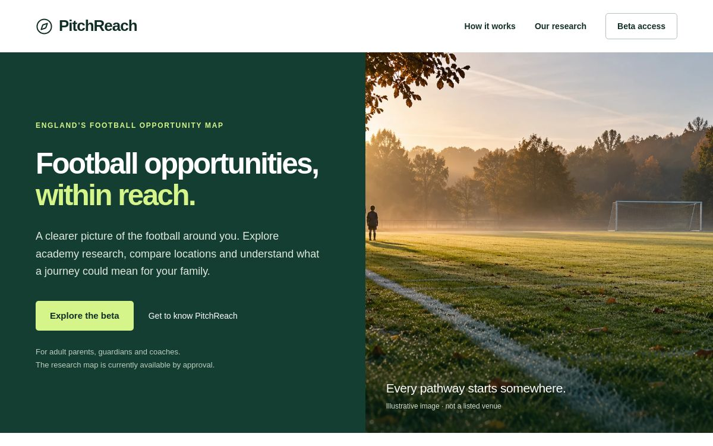

# PitchReach — Technical Case Study

**Isaac Adekunle · Product Builder · AI-assisted product engineering**

[Live beta](https://pitchreach.co.uk) · [Architecture](docs/architecture.md) · [Data model](docs/data-model.md) · [Decisions and development](docs/decisions-and-development.md) · [Validation](docs/validation.md) · [Screenshots](docs/media.md)

PitchReach is a football academy research product for adult parents, guardians and coaches exploring locations in England. It brings academy evidence, maps and postcode comparison into one interface, while making the limits of that evidence visible.

The central product question is: **how can incomplete research support a useful decision without pretending to measure a child's opportunity?** The answer shaped the data model, interface states, access controls and release boundaries.

This public repository presents the technical case study and selected product images. The application source, research registers and deployment configuration remain private. The engineering and validation findings below describe the **7 October 2026 audit checkpoint**; they are not continuously updated production metrics.

## Product at a glance

| Area | Evidence at the checkpoint |
|---|---|
| Audience | Adult parents, guardians and coaches researching academy access in England |
| Available product | Public introduction and an approval-gated research beta with a map, directory, field-level evidence and two-postcode comparison |
| Runtime stack | React, TypeScript, MapLibre, Vinext, Cloudflare Worker and D1 |
| Research coverage | 95 candidate academy records; 35 verified category classifications; 7 general venue points meeting the current category-and-venue filter |
| Validation | 72 Node tests passed; TypeScript, evidence integrity and register/hash checks passed; production build completed on 7 October |
| Important boundary | Journey calculations held for ordinary testers; national opportunity scores, colour bands and heatmaps withheld |

The 35 verified classifications do **not** mean 35 fully verified academy records. No retained venue had a verified player entrance. PitchReach does not predict professional-football success or establish academy eligibility.

*Historical saved-version image associated with the deployment updated 2 October 2026; retrieved 7 October. The exact capture time is unavailable. The pitch photograph is illustrative, not a researched venue. [Image provenance and limitations](docs/media.md).*

## From an idea to a bounded research product

The original problem combined a parent's practical questions: which academies are nearby, what is known about them, and how might location affect the effort of reaching them? A map alone could make an incomplete collection look comprehensive. A single score could give missing information the appearance of precision.

The implemented beta therefore separates academy category, location evidence, pathway context and measured travel information. An unknown entrance stays unknown; straight-line proximity is not presented as journey time. Research access requires application approval in addition to sign-in. National results remain withheld rather than being inferred from a small researched sample.

### Implemented, held and future work

| Status | Scope |
|---|---|
| Implemented in the inspected application | Map and directory; selected academy evidence; same-origin postcode lookup; two-location research comparison; adult membership and consent; limited JSON reporting |
| Implemented but restricted | Owner evaluation path for journey calculations; ordinary tester journeys held behind a server-side release gate |
| Withheld or incomplete | National scores and heatmaps; comprehensive academy/entrance coverage; a separate girls' pathway inventory |
| Separate development work | Python, FastAPI and PostGIS exploration; not the live research backend |
| Not evidenced in the runtime | LLM inference, model training or autonomous academy verification |

## One engineering lesson: missing evidence is not zero opportunity

An earlier assessment could show `0/100` when none of seven researched venues fell inside a selected travel budget. That was a result about a small sample, but readers could interpret it as a claim about all football opportunity in the location.

The correction preserves the measured sample count of zero while withholding the broader score and explaining the reason. A deterministic offline fixture reproduced the misleading result on the earlier source and passed against both the first correction and the audited baseline. A regression also checks the rendered assessment card. [Read the decision and iteration](docs/decisions-and-development.md#iteration-a-zero-score-that-exceeded-the-evidence).

## Product ownership and AI-assisted delivery

Isaac originated the problem, defined the intended audience and comparison brief, chose the brand and domains, and directed AI-assisted specification, prototyping and review. The project demonstrates product ownership through scope decisions, evidence requirements and a controlled release.

Implementation was AI-assisted. The retained implementation history records Codex as the commit author; this case study does not claim Isaac manually wrote every component. The 7 October audit, test reruns and documentation were assistant-executed under his instructions. AI is part of the development process; the inspected product uses curated research and deterministic rules. [Contribution boundaries and workflow](docs/decisions-and-development.md#human-contribution-and-ai-assisted-workflow).

## Explore the evidence

- [Architecture](docs/architecture.md): how browser, application, research and account data interact.
- [Data model](docs/data-model.md): field-level provenance, uncertainty and the measured inventory.
- [Decisions and development](docs/decisions-and-development.md): trade-offs, a reproduced defect and AI-assisted delivery.
- [Validation](docs/validation.md): dated results, their scope and the remaining tests.
- [Screenshots](docs/media.md): genuine historical product images with version-specific captions.

**Try the [live beta](https://pitchreach.co.uk).** The public homepage explains the product; research access requires sign-in and application approval. The next evidence milestones are an approved non-owner walkthrough, fresh research screenshots and a small adult pilot focused on whether people correctly interpret evidence and unavailable states.
