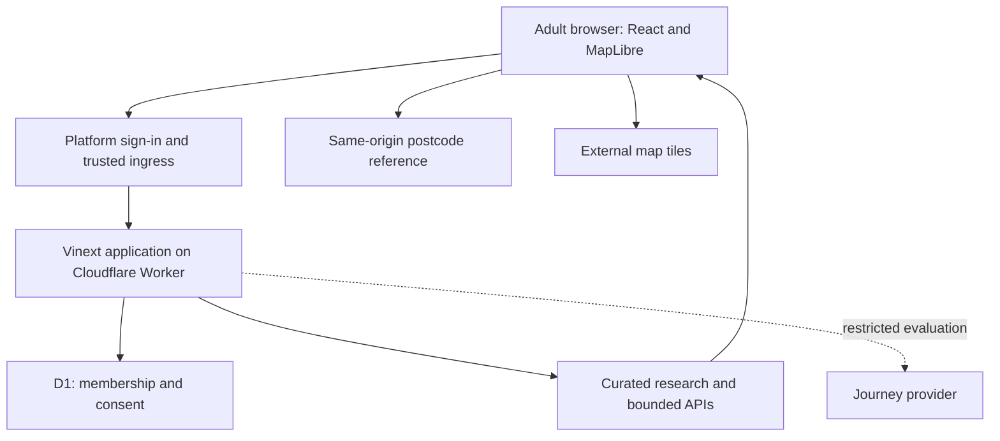

# Architecture

[Case study](../README.md) · [Data model](data-model.md) · [Validation](validation.md)

**Scope:** inspected application and deployment metadata at the 7 October 2026 checkpoint. This is a conceptual overview, not a published implementation or configuration guide.

## Runtime design

The interface uses React and TypeScript with MapLibre. Vinext provides Next-compatible application conventions and builds the application for a Cloudflare Worker. D1 supports account operations; curated server-side research is a separate data concern.

The diagram separates routine research from the restricted journey path. Map rendering and deterministic assessment logic execute in the browser; application policy controls access to research and provider operations.

## A research session

1. A visitor reads the public introduction, privacy notice and beta terms. Platform sign-in supplies identity; the application separately checks owner status or approved adult membership and accepted terms. Sign-in alone does not grant research access.
2. Research APIs serve selected map fields, a paginated directory and individual academy evidence. The initial browser response is not a download of the full evidence register.
3. A full postcode is resolved within a retained, same-origin district reference. The browser uses the result for straight-line distance and research scenarios. National postcode coverage does not establish national academy coverage.
4. MapLibre displays the map using OpenStreetMap raster tiles. A directory provides another way to inspect the research when the map cannot load.
5. A separate server-side gate controls journey calculations. Owner evaluation exists, while ordinary tester journeys were held at the audit checkpoint. When permitted, provider requests are subject to validation, limits and backoff. Public transport is unavailable, rather than silently replaced with driving.
6. An authorised report operation can produce reduced or fuller JSON output. The beta caller excludes the raw research register. A full report can contain selected scenario inputs, so export minimisation matters.

## Privacy and operational boundaries

- Adult account and consent records are separate from transient research scenarios. The inspected D1 schema has no stored child profile, household postcode or saved-scenario table.
- Scenarios remain in browser memory in the inspected paths. This does not erase reports a user downloads or logs held by hosting and external providers.
- Protected responses use private, non-cached handling and per-route access checks. Platform identity depends on the hosting ingress replacing untrusted identity headers; application tests alone do not prove that deployment guarantee.
- Public assets and licensed postcode reference files are distinct from protected research APIs.
- A directory fallback is useful resilience, but is not a completed accessibility certification.

## Development work outside the live path

Python import/validation work, a FastAPI development lookup and a PostgreSQL/PostGIS model are present as separate development artifacts. They are **not** the production browser's research backend. A proposed national grid publication path is disabled.

A future spatial backend would need a demonstrated product requirement, migration design and operational testing. Its presence in development work is not evidence that the live beta already depends on it.

No runtime LLM endpoint, training pipeline or autonomous academy-verification service was evidenced in the inspected application. [AI-assisted development](decisions-and-development.md#human-contribution-and-ai-assisted-workflow) concerns how the product was built.
