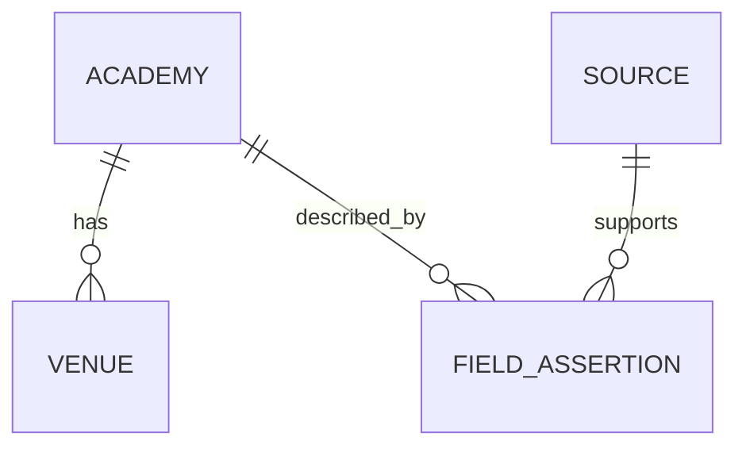

# Data model and evidence quality

[Case study](../README.md) · [Architecture](architecture.md) · [Decisions](decisions-and-development.md)

**Snapshot:** 7 October 2026. This is a conceptual description and aggregate inventory; it does not publish the underlying research register or database schema.

## The model follows the evidence

An academy is not represented by one universal confidence badge. Its category may be supported while its venue, age phase or player entrance remains uncertain. Keeping those claims separate allows the interface to explain what is known and what still requires research.

| Concept | Purpose |
|---|---|
| Academy | A research candidate with category, provision and status information |
| Venue | A location associated with an academy, including precision, phase/season context and entrance confidence |
| Source | A publisher or document with dates, access status and provenance |
| Field assertion | A claim about a particular field, linked to a source, with scope, confidence and retirement/supersession information |
| Release | The versions and integrity information associated with a research snapshot |
| Scenario and assessment | Temporary research inputs and an output with explicit states, denominators, exclusions and unavailable reasons |

These relationships are validated research conventions in the current JSON model. The diagram does not imply SQL foreign-key enforcement in the live research store. A verified field assertion never certifies an entire academy record.

## Measured inventory

| Measure | Result at the checkpoint | Interpretation |
|---|---:|---|
| Candidate academy records | 95 | Research candidates, not complete national coverage |
| Verified category classifications | 35 | 31 Category 1, 3 Category 2 and 1 Category 3 classifications |
| Whole records marked fully verified | 0 | Individual supported fields do not establish complete records |
| General points passing the default category-and-venue filter | 7 | A limited researched venue sample |
| Retained venues | 11 | Postcode-level points; no verified player entrances or confirmed effective seasons |
| Sources | 64 | Includes incompletely read or unavailable material; not all equally strong |
| Retained assertions | 312 | Includes confidence states and retired/superseded material |
| English postcode district shards | 2,223 | Same-origin lookup reference |
| Usable English postcode points | 1,494,158 | Representative postcode points, not household or entrance coordinates |

The postcode reference is broad enough for English lookup, but the academy evidence remains sparse. Combining the two does not justify a national opportunity score.

## Operational data stays separate

D1 supports adult membership, newsletter consent, consent events and operational limits. Newsletter consent is independent of research permission. No production account records were read for the case study.

The inspected schema has no child/player profile, household postcode, saved research scenario or persisted route-result table. Browser scenarios and downloaded reports have a different lifecycle from membership records.

## Why these distinctions affect the product

- **Missing and zero mean different things.** An unknown route is not a zero-minute route, and an unresearched area is not an area with no opportunity.
- **Comparisons need equivalent evidence.** A location must not appear better merely because fewer venues produced usable measurements.
- **Time and scope matter.** A general venue point does not confirm the correct current-season entrance for an age phase.
- **Versions belong with measurements.** Historical screenshots show earlier counts; they cannot replace the dated inventory above.

The retained audit checked evidence references, register parity and release hashes. Those integrity checks support consistency; they do not independently verify every real-world claim. [Validation scope](validation.md).
