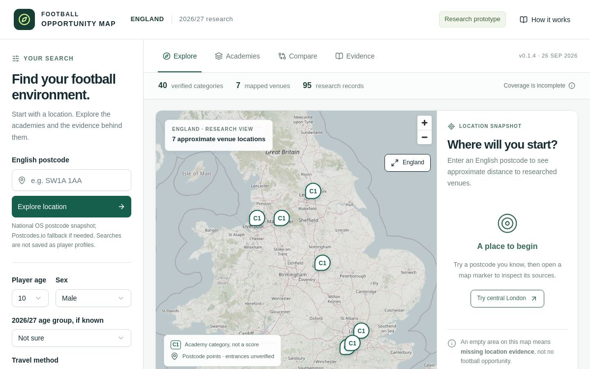
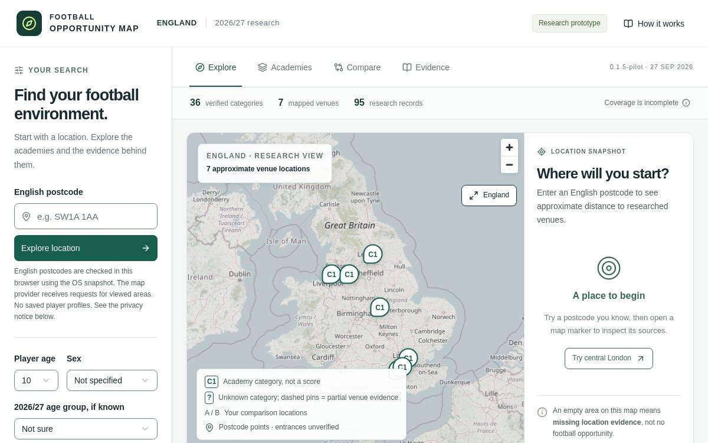

# Screenshots and live beta

[Case study](../README.md) · [Validation](validation.md) · [Live beta](https://pitchreach.co.uk)

The images below are genuine saved deployment screenshots. They were retrieved on **7 October 2026**; their exact capture timestamps were not independently available. Associated deployment dates identify their historical context. They have not been recreated as mockups or presented as fresh acceptance-test evidence.

## Public homepage — saved version 11

Associated deployment updated **2 October 2026**. This shows the public presentation and approval-gated research message. It is not proof of an authenticated research session. The pitch photograph is explicitly illustrative, not a listed academy venue.

## Research interface — saved version 4

Associated deployment succeeded **26 September 2026**. The screen identifies UI version `0.1.4` and shows 40 category classifications, 7 mapped points and 95 candidate records. It includes the earlier male default and external-postcode-fallback wording. These are historical interface details, not the current feature or data contract.

Map data: © [OpenStreetMap contributors](https://www.openstreetmap.org/copyright).

## Research interface — saved version 5

Associated deployment succeeded **27 September 2026**. The screen identifies UI version `0.1.5-pilot` and shows 36 category classifications, 7 mapped points and 95 candidate records. It shows the later unspecified default and same-origin postcode wording.

Map data: © [OpenStreetMap contributors](https://www.openstreetmap.org/copyright).

The **7 October inventory has 35 verified category classifications**. A lower count across versions is not a measured product-performance regression: evidence can be reviewed and reclassified. Neither research image depicts the synthetic zero-score regression scenario described in the [iteration walkthrough](decisions-and-development.md#iteration-a-zero-score-that-exceeded-the-evidence).

## What the images establish

They document the appearance and visible messaging of genuine historical product versions. The retained media register identifies saved deployments as their origin; it does not establish that either research capture came from an approved non-owner account. No current non-owner acceptance claim is based on these images.

No account email, credentials or submitted family-search input is visible in the selected images. The map scenes use a blank postcode field with an example placeholder and historical default controls.

## Visiting the beta

Open [pitchreach.co.uk](https://pitchreach.co.uk) for the public introduction. Research requires normal sign-in plus application approval. The signed-out homepage, privacy notice, terms and account gate were observed on 7 October; a fresh approved non-owner map/evidence/comparison walkthrough remains a next evidence milestone.
